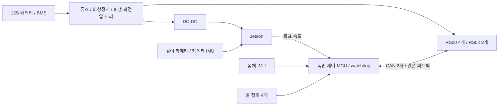

# 실물 설계·시험 계획

현재 결과는 실내 평지의 설계 후보를 좁힌 것이다. 체결 구조와 전원·방열·실제 센서 시험이 끝나야 제작안을 확정할 수 있다.

| 부품 | 수량 | 선택 이유 | 남은 확인 |
|---|---:|---|---|
| RS00 | 4 | 벌림 축의 무게·비용 감소 | 펌웨어, 방열, 정지 토크 |
| RS02 | 8 | 고관절·무릎 출력과 무게 절충 | 실제 관절 방향·제로점·발열 |
| D435i | 1 | 스테레오 깊이 + IMU, Isaac 공식 예제 | 현재 재고·견적, USB3, 진동·저조도 |
| Jetson Orin Nano Super | 1 | 이동체용 Ampere GPU 후보 | 8GB에서 VIO·Nvblox·Nav2 동시 부하 |
| 몸체 IMU | 1 | 자세 추정 | 자이로 바이어스·축 방향·타임스탬프 |
| 발 접촉/하중 센서 | 4 | 접지·미끄러짐 판단 | 단선·임계값·발 재질 |
| CAN 인터페이스 | 2 | 각 6축 200Hz, 계산상 최대 부하 약 39.1%/버스 | 오실로스코프·실제 프레임 손실 |
| 독립 제어 MCU | 1 | 통신 단절·과열 시 독립 차단 | RTOS/FDCAN 제어·watchdog 구현 |
| 12S 배터리·BMS | 1 | 44.4V 공칭·50.4V 만충 후보 | 무게·전류·충전·회생 흡수 |
| DC-DC·퓨즈·비상 정지 | 각 1 이상 | 계산기 전원과 모터 전원 분리 | 정격·전선·열·회생 과전압 |

Jetson 공식 페이지의 확인 가격은 $399이며 품절 상태였다. 모터와 합계 $2,059지만 이것은 완제품 비용이 아니다. 카메라·배터리·전원·프레임·센서·가공·배송·세금을 더해야 한다. [NVIDIA 판매 페이지](https://marketplace.nvidia.com/en-us/enterprise/robotics-edge/jetson-orin-nano-super-developer-kit/).

모터는 [제조사 자료](https://github.com/RobStride/Product_Information)를 기준으로 비교했다. RS02는 자료 개정에 따라 380g/7Nm과 405g/6Nm 표기가 달라 여기서는 405g/6Nm을 사용했다. RS00의 정지 연속 토크 3.6Nm과 RS02의 6Nm에 60%를 적용했다. 제조사 정격에 큰 방열판 조건이 있으므로 실제 프레임에서 이 값이 보장되지는 않는다. RS06 비교값에는 정지 정격 미확인 가정이 있어 구매 결론으로 쓰지 않는다.

카메라·몸체 IMU·관절 정보·발 접촉을 모두 쓰는 실물 제어는 센서가 갖춰진 뒤 완성한다. 현재 물리 실험은 몸체 IMU로 자세를 보정하고, 깊이 카메라와 위치로 경로를 계획한다. 발 접촉은 평가에 사용했으며 접촉 기반 전신 제어나 MPC는 구현하지 않았다. 초음파는 보조 근거리 정지 센서로 추가할 수 있지만 카메라 시야 밖 전체를 대신하지 못한다. 이번 새 프로젝트의 초음파 드라이버는 없다.

제작 전에는 모터 체결 도면, 축별 하중, 알루미늄 방열 경로, 배터리 실제 무게, 전선 간섭, 발 미끄럼과 접촉을 확인한다. CAD 입체 유효성은 이 검사를 대신하지 않는다.

시험 순서:

1. 모터 1개를 고정하고 펌웨어·CAN ID·관절 방향·소프트웨어 한계·비상 정지를 확인한다. 자동 영구 제로 설정은 하지 않는다.
2. 실제 프레임의 방열 조건에서 정지·반복 동작 토크와 온도를 기록한다. 시뮬레이션 한도를 측정 결과로 갱신한다.
3. 다리 하나로 하중·접촉·역기구학·케이블 간섭을 시험한다.
4. 로봇을 지지한 상태에서 12축 서기·전류·센서 단절을 확인한다. 현재 프로젝트는 실물 CAN 출력을 막아 두었다.
5. 바닥에서 저속 보행·정지·미끄럼·카메라 가림을 시험한다.
6. Isaac ROS 5.0에서 실제 카메라 보정·VIO·Nvblox 지도를 확인한 뒤 짧은 경로부터 자율 이동을 시험한다.

실험 결과가 기준에 못 미치면 더 큰 모터만 넣기보다 발 위치·다리 길이·몸체 무게와 방열 구조를 함께 바꾼다. 점프·두 발 서기·물구나무·박수·큰 춤은 별도 충격·접지 시험이 필요한 다음 단계다.
